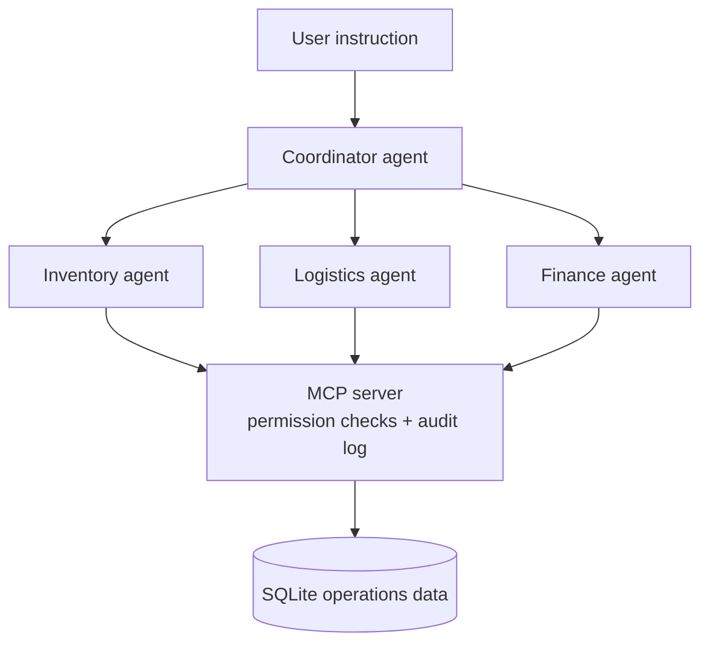

# ops-agents

A multi-agent operations assistant. A coordinator agent turns plain-English requests into tasks for specialist agents (inventory, logistics). Every agent reaches business data **only** through a [Model Context Protocol](https://modelcontextprotocol.io) (MCP) server tjat enforces per-agent permissions and logs every tool call .

> **Status:** early development. Phase 0 (foundation) is complete. See the [roadmap](#roadmap).

## Example

> *"Which shipments are at risk this week, and what's holding them up?"

The coordinator splits this into a logistics task (find delaed or at-risk shipments) and an inventory task (check the stock and supplier issues behind them). It send each task to the right specialist and combines their structures results into one answeer. Ever data access along the way is recorded in an audit log.

## Architecture (planned)



## Design decisions

**Agents only touch data through MCP.**
No agent queries the database directly. All data access gets through tools exposed by one MCP server, which gives one place to enforce permissions and log activity. The agents also don't depend on where the data lives; replacing SQLite with a real ERP or warehouse system would change the server, not the agents.

**Permission are enforced in code, not in prompts.**
Telling a model "don't access shipment records" in its prompts is a request it can ignore, or be manipulated out of through prompt injection. Instead, the finance agent is never given the shipment tools, so it can't call them whatever the prompt says.

**Every tool call is audited.**
Each call is logged with the agent, tool, arguments, result and timestamp. This makes the system debuggable ("why did it say that?"). It's also the kind of governance a business would need before letting agents near real data.

**Structured outputs, not free text.**
Agents return types, validated results rather than prose. The coordinator combines data instead of re-parsing sentences, and malformed output fails loudly instead of silently.

**SQLite for the operation data.**
SQLite needs no server and keeps everything in a single file, while still being real SQL. The database is generated from a seed script rather than committed, so anyone can rebuild it from scratch.

**A reproducible environment.**
Dependencies and the Python version are pinned with [uv](https://docs.astral.sh/uv/) and a committed lockfile ('uv.lock'). The code uses a 'src/' layout, so tests and the demo run the installed package, not whatever happens to be in the working directory.

**Secrets stay out of the repo**
The API key is read from a local '.env' file, which is git-ignored, '.env.example' documents which vasriables are needed.

## Roadmap

- [x] **Phase 0: Foundation.** Repo, environment, secrets handling
- [] **Phase 1: MCP Server.** SQLite operations dataset (orders, shipments, inventory, suppliers) exposed through MCP tools
- [] **Phase 2: First agent.** Answers questions from real data by calling MCP tools
- [] **Phase 3: Multi-agent and governance.** Coordinator, specialist agents, per-agent permissions, audit log
- [] **Phase 4: Interface.** FastAPI backend, minimal web UI, Docker packaging 
- [] **Phase 5 (stretch): Skill library.** RAG over business rules and documents, retrievable by agents

## Tech stack

Python 3.12 . uv . Model Context Protocol . Anthropic API . SQLite . FastAPI and Docker (planned)

## Getting started

Requires [uv](https;//docs.astral.sh/uv/getting-started/installation/).

```bash
git clone https://github.com/cynthea-rose/ops-agent.git
cd ops-agents
uv sync
cp .env.example .env #then add your Antropic API key to .env
```

## Author

Cynthea Rose Antony . [github.com/cynthea-rose](https://github.com/cynthea-rose)